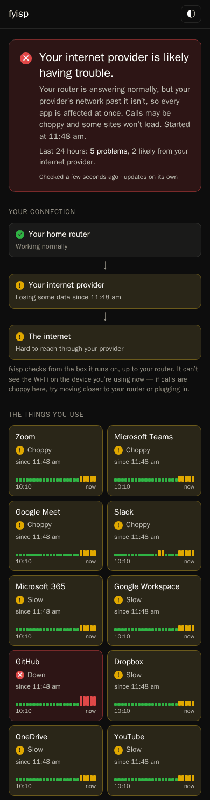

# fyisp

Is your internet good enough for calls and work right now, and when it isn't, is it your Wi-Fi or your internet provider? fyisp answers that in plain words and keeps 90 days of evidence: when it went wrong, for how long, and whose fault it likely was.

Run it now, with everything on (every target, calls and the Home tiles, and scheduled speed tests), on Linux or macOS:

```sh
curl --proto '=https' --tlsv1.2 -fsSL https://github.com/fuck-you-isp/fyisp/releases/latest/download/run.sh | sh -s -- --profile all --speedtest
```

Then open <http://127.0.0.1:3000>. Run the same command again to update. Windows, Docker, other ports and options: [Quick start](#quick-start).

fyisp ("F\*\*\* You ISP") is one small program for a home or a remote worker. It runs on your computer (or a NAS or Raspberry Pi), checks your connection every few seconds, and shows the answer at <http://127.0.0.1:3000>:

- **Calls, work apps and websites.** It checks the path that call audio and video take, the call and chat apps (Teams, Zoom, Google Meet, Slack, Webex, Discord, WhatsApp), Microsoft 365, Google Workspace, GitHub, Dropbox and OneDrive, the networks most websites are served from, and YouTube and Netflix.
- **Whose fault it is.** It also checks your own router and your provider's first hop, so it can say *your Wi-Fi or router*, *your internet provider*, *the wider internet* or *one app*.
- **Every app at a glance.** 11 tiles (Zoom, Microsoft Teams, Google Meet, Slack, Microsoft 365, Google Workspace, GitHub, Dropbox, OneDrive, YouTube and Netflix), each *Good*, *Slow* (*Choppy* for calls) or *Down*, with the last 2 hours in 5-minute bars. Drops of 30 seconds or more always show.
- **When it was bad.** The problems of the last 7 days, each with a *likely cause*: your home router (or Wi-Fi), your internet provider, the internet beyond your provider, or the app itself.
- **Evidence for your provider.** Home lists every problem of the last 7 days with its time, length and likely cause, and has no addresses on it, so a screenshot is safe to send. Technical details keeps 90 days of charts, and `fyisp export` writes the raw numbers as CSV (traceroute rows include hop addresses).
- **Private.** No account, no telemetry, nothing to install to try it. fyisp only talks to the services it checks and your DNS resolver. Its data stays on your machine.

Technical users get every number under **Technical details**: charts per service, traceroutes, call-quality scores, the outage log, Prometheus metrics, CSV export, and 1,400 more endpoints (clouds, CDNs, gaming, regions of the world) [one flag away](#what-to-measure-profiles).

> **The default is for homes and remote workers.** Plain `fyisp` makes 28 checks of calls, work apps and websites, one or more for each Home tile (see [Privacy](#privacy) to leave any out), and opens on the plain-words **Home** view. Cloud regions are one flag away: `--profile clouds` (or `aws`, `gcp`, `hetzner`, … ; see [What to measure](#what-to-measure-profiles)).

## Quick start

### Linux and macOS

```sh
curl --proto '=https' --tlsv1.2 -fsSL https://github.com/fuck-you-isp/fyisp/releases/latest/download/run.sh | sh
```

Then open <http://127.0.0.1:3000>. Pass options after `sh -s --`, e.g. `... | sh -s -- --profile streaming`.

Everything on, on port 8080 instead of 3000:

```sh
curl --proto '=https' --tlsv1.2 -fsSL https://github.com/fuck-you-isp/fyisp/releases/latest/download/run.sh | sh -s -- --profile all --speedtest --listen 127.0.0.1:8080
```

Leave out `--listen` for the default port 3000. Keep `127.0.0.1:` to stay local-only, where every control works without a token; `0.0.0.0:<port>` opens it to your network and turns the [admin token](#controls-under-docker) on. With `--profile all`, consider `--retention 30d`: 90 days of 1,421 targets takes a lot of disk.

To update, stop fyisp (Ctrl-C) and run the same command again: `releases/latest` always fetches the newest release, and your data stays in the data directory (see [Upgrading](#upgrading)).

The launcher (`run.sh`) is pinned to the release it came from. It downloads the matching binary into a temporary directory, **refuses to run it unless its SHA-256 matches the release's `SHA256SUMS`**, also checks the GitHub build provenance attestation if the [GitHub CLI](https://cli.github.com/) is installed and logged in, runs it, and deletes it when fyisp exits. Nothing is installed, so fyisp stops when you close the terminal: see [Keep it running](#keep-it-running).

### Windows (PowerShell)

```powershell
& ([scriptblock]::Create((irm https://github.com/fuck-you-isp/fyisp/releases/latest/download/run.ps1)))
```

Add fyisp options at the end, e.g. `... ))) --profile all --speedtest --listen 127.0.0.1:8080`. `run.ps1` does the same checks as `run.sh`, and rerunning it updates fyisp the same way.

### What you see: Home and Details


**Home** opens first. It answers one question, *is my internet OK for calls and work, and which apps work?*, in plain words. Numbers stay in the tile panels.

- **The answer card**: one sentence, e.g. *Everything you use is working normally.*, *Your internet provider is likely having trouble.*, *Your internet is fine. Zoom isn't connecting.* or, for 30 minutes after a drop, *Working again. Your internet dropped for about 40 seconds at 10:14 am.* The line under it gives the *likely cause* and what it means for you (*Teams and Google Meet are working if you need to switch*). Below that: how many problems the last 24 hours had, and when fyisp last checked. The card's color follows your connection, not the worst app: Zoom down on Zoom's side is a green card. The browser tab's title says the same in a few words (*✓ All good*, *✕ Provider problem*).
- **Your connection**: *Your home router → Your internet provider → The internet*, each with an icon (✓, ! or ✕) and a short line: *Working normally*, *Losing some data since 10:12 am*, *Dropped for 40 s at 10:14 am, fine now*. The first box says *Your Wi-Fi and router* only when fyisp runs on a Linux machine whose own connection is Wi-Fi and you are looking at the page on that same machine. Otherwise it says *Your home router*, with a hint: fyisp checks from the box it runs on, up to your router, and can't see the Wi-Fi of the device you're reading on. In Docker it always says *Your home router* (see [Wi-Fi or router?](#wi-fi-or-router)).
- **11 app tiles**: Zoom, Microsoft Teams, Google Meet and Slack (calls); Microsoft 365, Google Workspace, GitHub, Dropbox and OneDrive (apps); YouTube and Netflix (streaming). Each says *Good*, *Slow* (*Choppy* for calls) or *Down*, with *since 10:12 am* when it isn't Good, or *Dropped 40 s at 10:14 am* for 30 minutes after a drop. Under it, 24 bars show the last 2 hours in 5-minute steps: green, yellow (slow for 2 minutes or more), red (down, or a drop of 30 seconds or more) or grey (fyisp wasn't running). A tile your profile doesn't cover says *Not checked* and how to turn it on.
- **Click a tile** for its panel: why it has that word, its numbers against their limits (delay, jitter and loss for calls; the usual time and the *Slow above* limit for the others), and a 24-hour chart with the usual line, the problems and the time fyisp wasn't running. Escape or *Close* returns to the tile. *How fyisp decides Good, Slow, Choppy and Down*, under the tiles, explains the rules (see [below](#how-fyisp-decides-good-slow-choppy-and-down)).
- **Speed** (when [speed tests](#speed-tests) are on): your latest result in Mbps against your usual speed (once there are a few tests), and **Test speed now**, which runs one test against fyisp's built-in servers. It needs the admin token where the dashboard has one (see [Controls under Docker](#controls-under-docker)).
- **Problems in the last 7 days**: a summary by cause (*5 problems: 1 likely from your internet provider, 1 from your home router, 3 from the apps themselves*), then each problem with its time, what happened, its *likely cause* and one line of evidence (*Your router kept answering, but nothing past it did.*). A problem during one of fyisp's own speed tests says so.
- **The footer**: *Watching your connection since …* and **Technical details →**.



On a phone the strip stacks and the tiles take 2 columns (right: a problem at the internet provider, in the dark theme).

For its first day fyisp is still learning what's usual for your connection: Home says so and flags only big problems until then. If fyisp hasn't checked for 2 minutes or more (the computer it runs on is asleep, or fyisp stopped), the card turns grey, says since when, and the tiles are dimmed.

**Technical details** (*Technical details →* on Home; the *Home | Details* switch at the top goes back) is the full instrument panel: the verdict and outage log, the [Calls view](#call-quality) with scores per app and *What happened at …?*, the [Overview](#the-overview-large-profiles), charts for every service, traceroutes (*Investigate*), speed tests and CSV export.

### Download the binary yourself

Get `fyisp-<os>-<arch>` from the [latest release](https://github.com/fuck-you-isp/fyisp/releases/latest) (`linux-amd64`, `linux-arm64`, `linux-armv7`, `darwin-amd64`, `darwin-arm64`, `windows-amd64.exe`, `windows-arm64.exe`) together with `SHA256SUMS`, then verify and run it:

```sh
sha256sum -c SHA256SUMS --ignore-missing     # macOS: shasum -a 256 -c SHA256SUMS --ignore-missing
gh attestation verify fyisp-linux-amd64 --repo fuck-you-isp/fyisp   # optional
chmod +x fyisp-linux-amd64 && ./fyisp-linux-amd64
```

### Avoiding "unknown publisher" warnings

The binaries are not code-signed yet. Windows SmartScreen and macOS Gatekeeper only check files that carry the browser's "downloaded from the internet" mark, so:

- **Recommended: use the launchers above.** `run.ps1` (`irm`) and `run.sh` (`curl`) download without that mark, so there is no warning, and they refuse to run anything whose SHA-256 doesn't match `SHA256SUMS`.
- **Windows, browser download:** SmartScreen says "Windows protected your PC". Either choose *More info → Run anyway*, or, after verifying the checksum, remove the mark once: `Unblock-File .\fyisp-windows-amd64.exe`. Double-clicking the `.exe` opens a console window with the log and the dashboard address; closing the window stops fyisp. To pass options, run it from a terminal or put them in a shortcut's *Target*.
- **macOS, browser download:** Gatekeeper blocks it. After verifying it, run `xattr -d com.apple.quarantine fyisp-darwin-arm64`.

Code signing is planned: free Windows signing through the [SignPath Foundation](https://signpath.org/) (for open-source projects), and Apple notarization if there is demand.

### Docker

```sh
docker run -d --name fyisp --restart unless-stopped -p 3000:3000 -v fyisp:/data ghcr.io/fuck-you-isp/fyisp
docker logs fyisp 2>&1 | grep -m1 -o 'http://[^ "]*#admin=[0-9a-f]*'
```

Open the link that the second command prints (`http://127.0.0.1:3000/#admin=…`) once in your browser. It turns on *Test speed now* and the other speed-test controls for that browser; see [Controls under Docker](#controls-under-docker) below.

Images are published for `linux/amd64`, `linux/arm64` and `linux/arm/v7`. The container runs as an unprivileged user (65532) from a `scratch` image and keeps its data in the `/data` volume. `-p 3000:3000` makes the UI reachable from your network; use `-p 127.0.0.1:3000:3000` to keep it on this machine. ICMP works without extra capabilities on Docker 20.10+, which allows unprivileged ping sockets inside containers.

fyisp options go **after the image name** (the image already sets `--data-dir=/data --listen=0.0.0.0:3000`):

```sh
# No speed-test controls for anyone (the dashboard and Investigate stay open)
docker run -d --name fyisp --restart unless-stopped -p 3000:3000 -v fyisp:/data ghcr.io/fuck-you-isp/fyisp --admin-token=off
```

#### Controls under Docker

Inside a container fyisp listens on all interfaces, so anyone on your network could reach the UI. Speed-test controls (*Test speed now*, *Test every server*, cancel, the schedule and skipped servers) therefore need an admin token. On first start fyisp generates one, keeps it in the data volume (`/data/admin-token`, readable only by fyisp) and logs an "open this link" URL at every start, like Jupyter:

- Open the link once per browser. The page swaps the token for a cookie that only this dashboard sees and removes it from the address bar. The token is in the part after `#`, which browsers never send to a server, so it doesn't end up in proxy logs or `Referer` headers. Looking at the dashboard needs no token.
- Opening the dashboard from another machine: replace `127.0.0.1` with the server's address, e.g. `http://192.168.1.10:3000/#admin=…`.
- To sign every browser out, delete the token and restart; a new link is logged: `docker run --rm -v fyisp:/data busybox rm /data/admin-token && docker restart fyisp`.
- `--admin-token=<your own>` uses that token instead (the browser asks for it, or open `http://…:3000/#admin=<token>`). `--admin-token=off` turns speed-test controls off for everyone; the dashboard and Investigate keep working.
- The dashboard is plain HTTP: someone who can watch your network traffic could copy the cookie, as with any HTTP login. Keep it on a network you trust, or use `-p 127.0.0.1:3000:3000`.

*Investigate* needs no token: anyone who can open the dashboard can trace a profile target, for at most 250 rounds, 4 at once and 12 new traces an hour across all viewers. Opening the view starts one only for the owner: on this machine with a loopback dashboard without a token, or in a browser with the admin token (the link, or the token pasted for a speed test); other viewers click *Trace*. A browser with the token skips the hourly limit, not the 4 at once.

If you open the UI by a name instead of an IP address (`http://nas.local:3000`, a Tailscale MagicDNS name, a tunnel), add `--allow-host nas.local` (repeatable or comma-separated). Otherwise fyisp refuses the request with *421 unknown host*, which protects against DNS rebinding. Any `--allow-host` also turns the admin token on, even with the default loopback `--listen` (see [Remote access](#remote-access)).

**Use host networking on Linux for accurate verdicts.** With Docker's default bridge network the container's default gateway is Docker's bridge (`172.17.0.1`), not your home router, so the *Gateway* layer measures the bridge (always fine) and the *ISP edge* found by the path discovery is your router's WAN side or later. A Wi-Fi or router problem then shows up one layer too far out (as *ISP* or *Upstream*). Run the container in the host's network namespace instead:

```sh
docker run -d --name fyisp --restart unless-stopped --network host -v fyisp:/data ghcr.io/fuck-you-isp/fyisp --listen=127.0.0.1:3000
```

With `--network host`, `-p` is ignored: fyisp listens on the host directly (the image's default `--listen=0.0.0.0:3000` makes it reachable from your network; the `--listen=127.0.0.1:3000` above keeps it on this machine).

**Docker Desktop (macOS, Windows)** runs containers inside a Linux VM: the container's gateway is the VM's virtual network, every probe is NATed by the VM, and `--network host` means the VM's network, not your Mac's or PC's. The charts are still useful, but the Gateway and ISP edge layers (and so the *Wi-Fi/router* vs *ISP* verdicts) are not about your real network there. For layer-accurate verdicts, run the native binary on macOS and Windows (see [Quick start](#quick-start)).

## Keep it running

fyisp can only tell you about time when it was running. Started from a terminal or the launcher, it stops when you close that window or log out, and Home shows that time as grey bars, and as hatched bands in a tile's chart: *fyisp wasn't running*. To have it start by itself, install the binary once and register it with your system, as below. It then runs in the background whenever you're logged in (or, on Linux and Docker, whenever the machine is on) and you just open <http://127.0.0.1:3000>.

A laptop that sleeps still leaves gaps; that's expected and never counted as a problem. For a complete record, run fyisp on something that is always on and on the same network: a NAS, a Raspberry Pi or a home server, with [Docker](#docker) or [systemd](#linux-systemd).

### macOS (LaunchAgent)

In Terminal (Apple silicon; on an Intel Mac use `fyisp-darwin-amd64`):

```sh
mkdir -p ~/.local/bin && cd ~/.local/bin
curl -fsSLO https://github.com/fuck-you-isp/fyisp/releases/latest/download/fyisp-darwin-arm64
curl -fsSLO https://github.com/fuck-you-isp/fyisp/releases/latest/download/SHA256SUMS
shasum -a 256 -c SHA256SUMS --ignore-missing && mv fyisp-darwin-arm64 fyisp && chmod +x fyisp

cat > ~/Library/LaunchAgents/io.github.fuck-you-isp.fyisp.plist <<PLIST
<?xml version="1.0" encoding="UTF-8"?>
<!DOCTYPE plist PUBLIC "-//Apple//DTD PLIST 1.0//EN" "http://www.apple.com/DTDs/PropertyList-1.0.dtd">
<plist version="1.0"><dict>
  <key>Label</key><string>io.github.fuck-you-isp.fyisp</string>
  <key>ProgramArguments</key><array><string>$HOME/.local/bin/fyisp</string><string>--open-browser=false</string></array>
  <key>RunAtLoad</key><true/>
  <key>KeepAlive</key><true/>
  <key>StandardOutPath</key><string>$HOME/Library/Logs/fyisp.log</string>
  <key>StandardErrorPath</key><string>$HOME/Library/Logs/fyisp.log</string>
</dict></plist>
PLIST
launchctl bootstrap gui/$(id -u) ~/Library/LaunchAgents/io.github.fuck-you-isp.fyisp.plist
```

fyisp now starts whenever you log in. Its log is `~/Library/Logs/fyisp.log`. To stop it for good: `launchctl bootout gui/$(id -u)/io.github.fuck-you-isp.fyisp && rm ~/Library/LaunchAgents/io.github.fuck-you-isp.fyisp.plist`. Downloaded with `curl`, the binary carries no quarantine mark, so Gatekeeper doesn't block it.

### Windows (Task Scheduler)

In PowerShell (on an ARM PC use `fyisp-windows-arm64.exe`):

```powershell
$dir = "$env:LOCALAPPDATA\Programs\fyisp"; New-Item -ItemType Directory -Force $dir | Out-Null
$url = "https://github.com/fuck-you-isp/fyisp/releases/latest/download"
Invoke-WebRequest "$url/fyisp-windows-amd64.exe" -OutFile "$dir\fyisp.exe"
Invoke-WebRequest "$url/SHA256SUMS" -OutFile "$dir\SHA256SUMS"
$want = (Select-String -Path "$dir\SHA256SUMS" -Pattern 'fyisp-windows-amd64\.exe$').Line.Split(' ')[0]
if ((Get-FileHash "$dir\fyisp.exe").Hash -ne $want) { Remove-Item "$dir\fyisp.exe"; throw "checksum mismatch" }

$action  = New-ScheduledTaskAction -Execute "powershell.exe" -Argument "-NoProfile -WindowStyle Hidden -Command & '$dir\fyisp.exe' --open-browser=false"
$trigger = New-ScheduledTaskTrigger -AtLogOn -User $env:USERNAME
$settings = New-ScheduledTaskSettingsSet -ExecutionTimeLimit ([TimeSpan]::Zero) -AllowStartIfOnBatteries -DontStopIfGoingOnBatteries -RestartCount 3 -RestartInterval (New-TimeSpan -Minutes 1)
Register-ScheduledTask -TaskName fyisp -Action $action -Trigger $trigger -Settings $settings
Start-ScheduledTask -TaskName fyisp
```

fyisp now starts, hidden, whenever you log in. To stop it for good: `Unregister-ScheduledTask -TaskName fyisp -Confirm:$false`, then end `fyisp.exe` in Task Manager.

### Linux (systemd)

```sh
curl -fsSLO https://github.com/fuck-you-isp/fyisp/releases/latest/download/fyisp-linux-amd64   # or -arm64, -armv7
curl -fsSLO https://github.com/fuck-you-isp/fyisp/releases/latest/download/SHA256SUMS
sha256sum -c SHA256SUMS --ignore-missing
sudo install -m 0755 fyisp-linux-amd64 /usr/local/bin/fyisp
sudo curl --proto '=https' --tlsv1.2 -fsSL -o /etc/systemd/system/fyisp.service \
  https://raw.githubusercontent.com/fuck-you-isp/fyisp/main/packaging/fyisp.service
sudo systemctl daemon-reload && sudo systemctl enable --now fyisp
```

fyisp now runs whenever the machine is on, from boot. [`packaging/fyisp.service`](packaging/fyisp.service) runs it as a transient unprivileged user (`DynamicUser`) with a read-only system, no access to home directories and a system-call filter; data lives in `/var/lib/fyisp`. Options go in a drop-in (`sudo systemctl edit fyisp`), e.g. `Environment=FYISP_PROFILE=default,streaming`; the comments in the unit show how to pass other flags (e.g. `--speedtest`) or grant `CAP_NET_RAW`.

### Docker, NAS and Raspberry Pi

The [Docker command](#docker) above already uses `--restart unless-stopped`: the container comes back after a reboot as long as Docker itself starts at boot (the default on Linux; on Docker Desktop, turn on *Start Docker Desktop when you sign in*).

## Which apps are measured

Home has 11 fixed tiles, always in this order. With the default profile every one is checked:

| Tile | Kind | What fyisp checks (default) |
|---|---|---|
| Zoom | call | its website (`zoom.us`) over TCP; call quality from your [call path](#stun-servers) |
| Microsoft Teams | call | its website (`teams.microsoft.com`) over TCP; call quality from the Teams relay that Teams clients use (`worldaz.tr.teams.microsoft.com`) |
| Google Meet | call | its website (`meet.google.com`) over TCP; call quality from `stun.l.google.com`, the STUN server Chrome and Meet use |
| Slack | call | its website (`wss-primary.slack.com`) over TCP; call quality from your call path |
| Microsoft 365 | app | Outlook, the Microsoft 365 portal and Microsoft sign-in (`outlook.office365.com`, `www.microsoft365.com`, `login.microsoftonline.com`) |
| Google Workspace | app | Gmail, Google Docs and Google Drive (`mail.google.com`, `docs.google.com`, `drive.google.com`) |
| GitHub | app | `github.com` (the catalog target is named `dev-GitHub`) |
| Dropbox | app | `www.dropbox.com` |
| OneDrive | app | consumer OneDrive's front door (`skyapi.onedrive.live.com`); work OneDrive on your company's SharePoint isn't checked |
| YouTube | stream | `www.youtube.com` |
| Netflix | stream | `www.netflix.com` |

- **Several targets per tile** are judged by majority, so one target that fails alone doesn't make Microsoft 365 or Google Workspace *Down*.
- **Zoom and Slack** (whose huddles run on Amazon Chime), like Discord, WhatsApp and Webex, hand out a media server per meeting, only after you sign in, and those servers ignore STUN without that session. They can't be tested ahead of a call, so their call quality is judged from your general call path (the panel says so); if your call path is Good, they usually are too.
- **The Teams relay** is the Microsoft server Teams calls go through; fyisp sends it tiny call-setup (STUN) packets to judge Teams' call quality. (It is GeoDNS, Azure Traffic Manager, not anycast, and can switch region between lookups; the Calls view shows where it landed, *via Sweden Central*.) Microsoft does not document it as a public STUN service (see [docs/STUN-TERMS.md](docs/STUN-TERMS.md)), but it is in the default. To leave it out, use a `--config` file with `extends: [default]` and `remove: [Teams-Relay]`: Teams is then judged on your call path plus its website.
- **Not on Home:** the networks most websites are served from (Cloudflare, Akamai, Fastly, CloudFront, Google's edge) and Webex, Discord and WhatsApp. They are still checked, count toward the [verdicts](#whose-fault-is-it-verdicts), and have their charts under Technical details, as does every target of the other [profiles](#what-to-measure-profiles).
- **Tiles your profile doesn't cover** say *Not checked*, with how to turn them on. `--profile calls` alone covers the 4 call tiles; `services-productivity` adds Microsoft 365, Google Workspace, Dropbox and OneDrive, `services-dev` GitHub, and `streaming` YouTube and Netflix.
- **A `--config` file** feeds a tile only through a target's `tile:<id>` tag (`tile:zoom`, `tile:teams`, `tile:meet`, `tile:slack`, `tile:m365`, `tile:gws`, `tile:github`, `tile:dropbox`, `tile:onedrive`, `tile:youtube`, `tile:netflix`), never by name. Start the file from `extends: [default]` (catalog targets keep their tags), or tag your own targets. An `override` that sets `tags:` replaces all of a target's tags, so keep its `tile:` tag. Removing a target (see [Privacy](#privacy)) turns its tile *Not checked*.

## How fyisp decides Good, Slow, Choppy and Down

This is what *How fyisp decides* under Home's tiles says, with the numbers behind it.

- **Calls** (Zoom, Teams, Meet, Slack) are judged on their UDP call path over the last 3 minutes. They are **Choppy** when the delay is over 150 ms, the jitter over 30 ms, or 2% or more of packets are lost (in at least 2 bursts: one unlucky burst isn't enough), the points where people start to notice on a call. **Down** means a delay over 400 ms, 10% loss or more in each of the last 2 minutes, or not connecting (their website or call server stops answering). Too few answers is *not enough data*, never a problem.
- **Everything else** is **Slow** when a check takes more than twice its usual time *and* at least 30 ms longer, or when a quarter or more of its checks in a minute get no answer. **Down** means it isn't answering: most checks fail. Slowness alone never makes an app *Down*, YouTube and Netflix included.
- **YouTube and Netflix** buffer ahead, so slowness never marks them Down; only failing to load does. If they buffer, test your speed.
- **Drops of 30 seconds or more always show**, even when everything recovers: the bar turns red, the tile notes *Dropped 40 s at 10:14 am* for 30 minutes (the most recent drop only), and the drop is listed under problems. A drop counts only when most of an app's checks fail together, so one flaky server can't set it off; shorter blips leave nothing behind. When your whole connection dropped, the card says *Working again* with the likely cause for 30 minutes.
- **Words don't flicker.** For slowdowns, a tile's word changes once 3 of the last 5 minutes are bad, and goes back to *Good* after 5 good minutes in a row. Outages show at once and clear as soon as the checks answer again.
- **"Usual"** is learned from your own connection over the last day, per target, leaving out bad minutes. For the first day fyisp uses fixed limits (*Slow* above 300 ms). A lasting route change is learned again after about an hour; a new router or network (a laptop that moved) starts over.
- **Likely cause** comes from comparing your router, your internet provider's first stop, the internet beyond it and all the apps at the same moment. It's a strong hint, not proof. Problems during one of fyisp's own speed tests are put down to the test.

The card follows the [verdict](#whose-fault-is-it-verdicts) (the last minute, every 5 seconds) and the tiles are judged minute by minute, so for a minute or two they can disagree.

## Whose fault is it? (verdicts)

Above the charts, fyisp shows one plain-English verdict, re-evaluated every 5 seconds over the last minute of probes, and keeps an outage log of every period that was not *ok*. A target is unhealthy when it loses at least 20% of its probes (and at least 2 in the minute: a single lost connect out of four is noise) or its median latency is far above its own 30-minute baseline. The first matching kind wins:

| Kind | Meaning |
|---|---|
| `no_network` | This device has no working connection (no route, every layer unreachable). |
| `lan` | The *Gateway* (your router) is unhealthy: Wi-Fi, cable or the router itself. |
| `isp` | The router is fine, the *ISP edge* (first public hop past it) is not: your ISP's access network. |
| `upstream` | Router and ISP edge are fine, but the anycast resolvers or most monitored services (in more than one group) fail: beyond your ISP. |
| `dns` | The path works, but at least 30% of the services can't be resolved. |
| `service` | Only some services are unhealthy: their problem, not yours. |
| `udp_blocked` | Everything above is fine, but UDP (STUN) to at least two independent providers has timed out 10 bursts in a row, port 53 included: calls fall back to slower TCP relays. Also a firewall on your own computer. |
| `stun_blocked` | As `udp_blocked`, but STUN on UDP port 53 still answers: the call ports are blocked, UDP itself is not. |
| `udp_degraded` | Everything above is fine, but the UDP path to at least two STUN providers has lost at least 5% of packets or jittered by 30 ms or more for 3 minutes. |
| `ok` / `warming_up` | Everything looks fine / the first minute after start. |

The UDP kinds wait 2 minutes after start (or for the first STUN answer), so a network that blocks UDP from the start is still caught, and a STUN server that is down alone never raises them. Hotel and office networks often block UDP for good: after 6 hours `udp_blocked`/`stun_blocked` is marked quiet and shown as information.

Loss on an inner link shows on every layer beyond it, so the verdict blames the innermost lossy layer: the gateway or ISP edge is blamed once it has lost at least 5 probes and 10% of them and the layers beyond it lose at least half as much. A layer further out is blamed only when its loss is significantly higher than that of the layers inside it (a two-proportion test on the minute's counts), so a few unlucky probes can't point at the wrong layer.

A new problem must hold for about 10 seconds before it is shown, and the verdict returns to *ok* only after a full minute without problems. Verdict summaries never contain addresses or host names. Every host name is looked up again every 60 seconds. After one failed lookup fyisp keeps probing the last good address; after two in a row (about 70 seconds into a resolver outage) the host's probes count as lost with reason *DNS*, as a real application would fail too, until a lookup succeeds again.

The layers come from the built-in **Network path** group, shown first: the *Gateway* and the *ISP edge* (found automatically from the routing table and a short traceroute; pinged every second) and two public anycast resolvers (1.1.1.1, 8.8.8.8; ICMP and TCP). A profile passed with `--config` keeps this group unless it sets `path: false` at the top level (`--no-path` does the same for `--profile`); without it fyisp can still tell `dns`, `service` and `upstream` apart, but not `lan` from `isp`.

### Wi-Fi or router?

fyisp measures from the machine it runs on, so it can only speak for that machine's own Wi-Fi. Home's first box says *Your Wi-Fi and router* only when all of these hold; otherwise it says *Your home router*, with a hint that fyisp can't see the Wi-Fi of the device you're reading on:

- **fyisp's own connection is Wi-Fi.** This is detected on Linux only (from `/sys/class/net`). macOS and Windows report it as unknown.
- **fyisp is not in a container.** Inside Docker (and Podman, systemd-nspawn, LXC, Kubernetes) the network fyisp sees is the container's, so it always uses the router wording. fyisp counts as containerized when `/.dockerenv`, `/run/.containerenv` or `/run/systemd/container` exists or `$container` is set (the release image sets `container=oci`).
- **You are looking at the page on that same machine:** the request comes from a loopback address or one of the machine's own addresses, carries no proxy header (`Forwarded`, `X-Forwarded-For`, `X-Real-Ip`, `Cf-Connecting-Ip`, `Tailscale-User-Login`), and doesn't use an `--allow-host` name. Through a reverse proxy, a tunnel (cloudflared, Tailscale Serve) or from another device on your network, Home uses the router wording.

A forwarder that adds no proxy header (`ssh -L`, `socat`) looks like the same machine, so a page opened through one says *Your Wi-Fi and router*. Only the wording changes; the measurements and the verdicts are the same. Whether you're on the same machine is decided per request and never stored, logged or cached, and the API returns only the resulting words, not your address.

## Call quality

Call audio and video travel over UDP, and a TCP connect says little about them. fyisp therefore also measures the UDP path with tiny STUN requests, the same kind of packet a call app sends before every call, and answers two questions: *is my connection good for calls right now?* and *why did my call at 14:14 go bad?*

### The Calls view

Home's call tiles (Zoom, Microsoft Teams, Google Meet and Slack) are judged on these measurements (see [How fyisp decides](#how-fyisp-decides-good-slow-choppy-and-down)). **Technical details** has the full view: **Calls | Overview | Charts** switches between them, and Details opens on Calls whenever the profile has STUN targets (as `default` and `calls` do); otherwise on the charts, or on the Overview when the profile is large.

- **The top card** gives one answer, e.g. *● Good for calls · 32 ms · 0% loss · steady*, refreshed every few seconds with *updated 4 s ago*: the pre-call check. It is the worst of the path verdict (it never says Good while the banner shows an ISP outage, and it names that cause inline), the UDP verdicts below, your call path's score and the measured apps' scores. When it is not Good it says why, e.g. *Poor: 8% loss on your call path (worst minute 14:12)*.
- **Working hours**: a strip for Mon–Fri 09–17 local time, colored per minute (good, fair, poor, unusable, no data), with a summary such as *Today 09–17: Good 92% · Poor 14:10–14:16*. Click a minute to ask about it.
- **What happened at …?**: pick a time (the default is the last 60 minutes) and get one sentence about the 15 minutes either side of it that names the layer at fault, e.g. *14:10–14:16: 8% loss at your ISP edge; Wi-Fi/router fine*. It uses the outage log, so it blames layers the same way the verdicts do. It links to the charts.
- **By app**, over the last 5 minutes: Meet and Teams get a state, round trip and loss from their own STUN servers; expanding a row shows the MOS, jitter, p95 round trip and the last hour. If you remove the Teams relay (see [Which apps are measured](#which-apps-are-measured)), Teams' row says whether its website answers and that its calls take your call path. Zoom, Slack, Discord, WhatsApp and Webex share one row (see below) that says whether their websites are reachable over TCP.

A STUN server that stops answering while the others still answer is shown as *This test server isn't answering; your other call checks look normal*. After a start the view says *Not enough data yet* until 10 bursts have been measured.

### How it is measured

- Every STUN target gets **one long-lived UDP socket**, as a real call does (one address and port pair, so there is no new NAT mapping per sample). It is reopened only when the server's address changes or after an error.
- Each sample is a **burst of 5 STUN Binding Requests, 20 ms apart** (RFC 5389, 20 bytes each, no attributes; never TURN, never credentials). Bursts run every 5 seconds per target unless the [list below](#stun-servers) says otherwise.
- A burst records the **median round trip**, the **in-burst jitter** (the mean difference between consecutive round trips, close to what a call's jitter buffer sees) and **loss**: requests not answered within 1 s. Only timeouts count as loss. A refused port or a failed DNS lookup is *unknown*, never loss. `--timeout` does not apply to UDP.
- A burst never spans an address change, so a GeoDNS server switching region (the Teams relay) is never counted as jitter.
- Each one-minute bucket is scored on its own, and a window is judged by its **worst minute**: a 5-minute mean would hide a 30-second stall.

#### STUN servers

This is the one list of the STUN servers fyisp ships; the catalog files ([`calls-stun.yml`](internal/profile/catalog/calls-stun.yml), [`twilio.yml`](internal/profile/catalog/twilio.yml)) are the source of truth. Each server's terms are reviewed in [docs/STUN-TERMS.md](docs/STUN-TERMS.md).

| Target | Server | Every | Profile | Role |
|---|---|---|---|---|
| Meet-STUN | `stun.l.google.com:19302` | 5 s | `default`, `calls` | call path (anycast); Google Meet |
| Meet-STUN-3478 | `stun.l.google.com:3478` | 5 s | `calls` | call path; Google Meet, for networks that block 19302 |
| Cloudflare-STUN | `stun.cloudflare.com:3478` | 5 s | `default`, `calls` | call path (anycast) |
| Cloudflare-UDP53 | `stun.cloudflare.com:53` | 15 s | `default`, `calls` | call path; also tells *STUN ports blocked* from *UDP blocked* |
| Twilio-STUN-global | `global.stun.twilio.com:3478` | 5 s | `default`, `calls` | call path (GeoDNS to the nearest Twilio region) |
| Twilio-us1 … Twilio-in1 | `{us1,us2,ie1,de1,sg1,jp1,au1,br1,in1}.stun.twilio.com:3478` | 30 s | `calls` | fixed regions, a world map of the UDP path (not in the call path) |
| Teams-Relay | `worldaz.tr.teams.microsoft.com:3478` | 5 s | `default`, `calls` | call path (GeoDNS to an Azure region); Microsoft Teams |

### The score

A simplified ITU-T G.107 E-model turns round trip, jitter and loss into an R factor, and R into a mean opinion score (MOS, 1 to 4.5):

```
delay = rtt/2 + 2·jitter + 10                              (one way, ms)
R     = 93.2 − delay/40            (delay < 160 ms)
R     = 93.2 − (delay − 120)/10    (delay ≥ 160 ms)
R    −= 2.0 per % loss up to 5 %, then 2.5 per % above     (R clamped to 0..100)
MOS   = 1 + 0.035·R + 7·10⁻⁶·R·(R − 60)·(100 − R)
```

The loss penalty is softer than G.711's tables because Opus forward error correction and packet-loss concealment (Meet, Teams) hide some loss. The bands are G.107's user-satisfaction bands:

| Band | MOS | R |
|---|---|---|
| Good | 4.0 and up | about 80 and up |
| Fair | 3.6 to 4.0 | 70–80 |
| Poor | 3.1 to 3.6 | 60–70 |
| Unusable | below 3.1 | below 60 |

*Your call path* combines the anycast and GeoDNS STUN servers marked *call path* above: each minute takes the median of the servers' round trip, jitter and loss, so one bad server does not make the path bad.

### Verdicts, metrics and the off switch

- **Verdicts.** `udp_blocked`, `stun_blocked` and `udp_degraded` (see [Whose fault is it?](#whose-fault-is-it-verdicts)) fire only when the path and TCP are healthy and at least two independent STUN providers agree, so a single dead STUN server never raises one. After 6 hours a blocked verdict turns quiet: it is shown as information (*It has been this way for hours (common on hotel and office networks)*), and the Calls rows say *Blocked*, not *Unusable*. UDP loss never feeds the main verdict or a service's loss.
- **Metrics.** `fyisp_udp_rtt_seconds`, `fyisp_udp_jitter_seconds` and `fyisp_udp_loss_ratio` per STUN target, and `fyisp_call_mos{app}`; see [Prometheus metrics](#prometheus-metrics).
- **`--no-udp`** leaves out every STUN target and hides the Calls view. Nothing else changes.

### Limits

- **Anycast targets measure the path to the nearest edge.** Anycast and GeoDNS servers answer from a data centre near you, not from the meeting's media server or the other people on the call. Most call problems are on your own connection, which is exactly that path; a problem beyond the provider's edge is not seen.
- **Idle probes miss bufferbloat.** Calls often break when the link is busy (an upload, a backup, someone streaming), because queues only fill under load. fyisp's probes are tiny and see a quiet link, so a call can be bad while the strip is green. Mark the call, and compare with the TCP charts at that time.
- **IPv4 only.** STUN is measured over IPv4; a call that goes over IPv6 takes a path fyisp doesn't measure.
- The score is a model, not the app's own rating: expect it to agree on the band, not the decimal.

## Speed tests

fyisp can measure your download and upload speed around the clock, so you can see whether your connection gets slower at certain times of day (the classic evening dip when everyone streams), and whose network the slowdown is in. **It is off by default.** Switch it on with `--speedtest`, or pick a mode in Details → Speed (the choice is saved). "Test now" (or *Test speed now* on Home) queues one test, and "Test every server" a sweep of every server, in any mode. Tests run one at a time from a single queue (scheduled ones included), and results you asked for are kept out of the time-of-day patterns.

```sh
fyisp --speedtest                                  # mode regions: 9 regions, each once an hour
fyisp --speedtest=regions,add=canada,us-northwest  # plus opt-in regions
fyisp --speedtest=nearby                           # 3 nearby providers and 1 far region, every 15 minutes
fyisp --speedtest=nearby,far=us-west               # plus another far region
fyisp --speedtest-server 192.168.1.20:5201 --speedtest=every=5m   # your own iperf3 server: no minimum
fyisp --speedtest-server Leaseweb-Tokyo,OVH-Sydney                 # chosen catalog servers (mode custom)
```

**Modes:**
- **`regions`**, the default once switched on: 9 regions (UK, Western Europe, Central Europe, US East, US Central, US West, East Asia, Southeast Asia and Oceania), each tested once an hour.
  - Only one test runs at a time; the regions are spread over the hour, about 400 seconds apart, in an order and at minutes that differ per install, with a minute of jitter on each hour's start.
  - Each region has servers from several providers in the same city. The provider rotates by hour and day, so every hour of the day is measured with every provider within a few days.
  - Opt-in regions (`add=`): US Northwest, US Mid-Atlantic, US Midwest, US Southeast, Canada, US Bay Area, South America, Central Asia, Netherlands and UK North.
  - Results show whether a dip is your line (every region and provider at once), one provider, one route or one server.
- **`nearby`**: the nearest server of 3 different providers (same city preferred), plus one far region (US East from Europe, London from the US; `far=` adds more), each every 15 minutes. The nearby servers are picked again daily. It is lighter on distance, heavier on frequency.
- **`custom`**: the servers you list with `--speedtest-server`, catalog ids or `host:port` of your own iperf3 server, each every 15 minutes.
- `every=` sets the interval per region or server (at least 15 minutes against public servers).

**What is sent, to whom.** Each test is an iperf3 test over IPv4, built into fyisp, so nothing has to be installed:
- download, then upload, each with 8 parallel TCP streams;
- the ramp-up (until the speed levels off, decided afterwards) is left out; a direction runs at most about 11 seconds, ramp-up included;
- then 3 to 10 seconds are measured, stopping once the speed has levelled off and held steady for 3 seconds (a second within 5% of the one before): up to 10 seconds each way, whatever the data.
- speeds are what TCP delivers (goodput): about 4–6% below the line rate your ISP sells, because of packet headers. A 1 Gbit/s plan reads about 940–960 Mbit/s at best.

The servers are public iperf3 servers run by hosting companies and volunteers: Leaseweb (16), OVH (12), Clouvider (9), InterServer (3), Hurricane Electric, Scaleway, Eranium, Uztelecom and Edgoo. All 45 are listed with their sources in [`internal/profile/catalog/iperf3/`](internal/profile/catalog/iperf3/), with the regions in `regions.yml`. The list is built into fyisp and changes only with a release. Like every probe target, they see your public IP address.

**How much it costs your line.** A speed test fills the line while it runs, by design:
- **Time under test:** mode `regions` keeps the line under test about 5% of the time (9 tests of 10 to 25 seconds an hour); `nearby` about 7%. Details shows the planned share for each mode. fyisp warns when your settings would exceed 25%.
- **Data:** a test moves your line's speed for 4 to 11 seconds each way; there is no byte cap. Mode `regions`, the default, runs 216 tests a day:

  | Your line | Data a month (mode `regions`) |
  |---|---|
  | 25 Mbit/s | about 150 to 450 GB |
  | 100 Mbit/s | about 650 GB to 1.8 TB |
  | 1 Gbit/s | about 6.5 to 18 TB |
  | one "Test every server" sweep | Details estimates it from your recent tests |

  Mode `nearby` uses about 1.8 times as much. Details shows the data used in the last 24 hours and this month, and an estimate for each mode.
- **Fast lines:** a test still speeding up when its 10 seconds end (a far server on a fast line) shows "≥": the speed was at least this. Speed tests show when your speed drops, not whether you get your plan's advertised speed.
- **Metered lines:** leave speed tests off on metered or capped connections.

**Be kind to the servers.** The operators and what fyisp sends them are listed in [`docs/IPERF3-TERMS.md`](docs/IPERF3-TERMS.md); [`docs/OPERATORS.md`](docs/OPERATORS.md) is for the operators themselves. Each server port runs one test at a time.
- If a port is busy, or refuses for a moment (a stock iperf3 server re-listens after every test), fyisp tries up to 2 more ports.
- Then it moves to another provider in the same city, then to a nearby city. Single-port servers (Hurricane Electric) are never retried. If nothing answers, it records **"server busy"**, never a slow result.
- A slot never uses more than about 30 seconds and never delays the next one.
- A server that was busy 3 scheduled tests in a row rests for 6 hours.
- `--speedtest-skip=<id,…>` (or the toggle per server in Details → Speed) never tests a server again: honour an operator's request without waiting for a release.

**One test at a time.** Scheduled tests, Test now and sweeps share one queue: your own requests first, then scheduled ones. A running test is never interrupted, except when you cancel it. A scheduled test that waited more than 10 minutes is dropped. Details shows the queue with estimated start times.

Please don't run modes more often than every 15 minutes against these servers. For more frequent tests, run your own: `iperf3 -s` on a VPS or another machine, then `--speedtest-server host:5201`.

**What you get.** For each test:
- download and upload speed, and how long each was measured;
- a **score** against that server's own normal (the 90th percentile of its last 14 days), so slow and fast servers compare;
- TCP retransmits;
- the region, the server, and the fallback level (`none`, `same_metro` or `nearby_city`);
- whether the server's own link was the limit (a result within 10% of its published capacity);
- **latency under load**: the round-trip time to your ISP's first router (behind your line's queue) and to your own router, in the 2 minutes before the test and during its download and upload, pinged every 150 ms; lost pings count. A big jump at the ISP's router is bufferbloat, the reason calls break while someone uploads; a jump at your own router is your home network (often Wi-Fi).
- **connection type** (wired or Wi-Fi, Linux) and, locally, **the first network past your ISP** on the way to each server (a traceroute at most once a day per server).

Details → Speed shows:
- what the slowdown points to: your provider's network (every region and provider dips together, checked against your provider's first router), the link to one provider, one long-distance route, or one server's own busy hours, with the evidence and how sure it is;
- a heatmap of regions × hour of day by score, with how many tests and providers back each hour;
- a time series per region and server, a table, and compare;
- a note when a region mostly used its fallback in the last day.

Home shows your latest result against your usual speed (the median of the last 7 days' tests), e.g. *Your speed: about 930 Mbps down / 940 Mbps up — about your usual speed.* When every region and provider dips at the same time of day, Details → Speed says so, for example *Every region slows from about 7 to 11 pm … most likely your internet provider's own network.* Only scheduled tests count toward patterns: Test now and sweeps don't. `fyisp export --speedtests` writes every test as CSV.

**Probes keep running during a test.** Their results are stored as measured, so a test that slows your line shows up as a latency spike or loss, and can count toward the verdict. The "show speed tests" toggle under each chart (off by default) marks when tests ran, so a spike can be matched to a test. Latency under load comes from the same probes. `/api/speed` reports the share of the last 24 hours spent under test (`test_share_24h`).

Limits: one test at a time, at most 15 seconds per direction and 45 seconds per slot, retries included; IPv4 only.

## What to measure (profiles)

By default fyisp measures **28 targets** a home and a remote worker rely on, plus your own [network path](#whose-fault-is-it-verdicts) (router, your provider's first hop, two public DNS resolvers):

| Group in Details | Targets | Home tiles they feed |
|---|---|---|
| Call path | 5 STUN servers ([list](#stun-servers)): Google Meet's, Cloudflare's (on its STUN port and on port 53), Twilio's and the Microsoft Teams relay | call quality for Zoom, Microsoft Teams, Google Meet and Slack |
| Call & chat apps | Microsoft Teams, Zoom, Google Meet, Slack, Webex, Discord, WhatsApp | Zoom, Microsoft Teams, Google Meet, Slack |
| Work apps | Outlook, the Microsoft 365 portal, Microsoft sign-in, Gmail, Google Docs, Google Drive, GitHub, Dropbox, OneDrive | Microsoft 365, Google Workspace, GitHub, Dropbox, OneDrive |
| Websites | Cloudflare, Akamai, Fastly, Amazon CloudFront and Google's edge, the networks most websites are served from; YouTube and Netflix | YouTube, Netflix |

Each service gets a TCP connect (handshake, then close; no data, no login) every 15 seconds. The STUN servers get a burst of 5 tiny Binding Requests every 5 seconds ([Call quality](#call-quality)); `--no-udp` leaves them out. A STUN server sees your public IP address, as every other target does. Its answer contains that address too (that is what STUN is for); fyisp skips it without decoding it and never stores, logs or exports it. `fyisp profiles default` lists every target with its host.

**Everything else is opt-in.** `--profile` picks from the built-in **target catalog** (about 1,400 endpoints, one file per provider in [`internal/profile/catalog/`](internal/profile/catalog/), every endpoint checked by hand). For containers, compose files and NAS templates, the environment variable `FYISP_PROFILE` does the same; `--profile` and `--config` win over it.

```sh
fyisp profiles                       # list the profiles, with target and panel counts
fyisp profiles aws                   # the targets of a profile (region, city, country)
fyisp --profile default,streaming    # the default plus streaming (combine profiles: a union)
fyisp --profile clouds --geo eu      # only the targets of a profile in one region (na sa eu me af as oc)
FYISP_PROFILE=default,calls fyisp    # the same as --profile default,calls
docker run ... -e FYISP_PROFILE=default,streaming ghcr.io/fuck-you-isp/fyisp
```

| Profiles | What |
|---|---|
| `default` | the 28 services above: calls, work apps, websites (used without `--profile`) |
| `calls` | call quality in depth: every [STUN server](#stun-servers), including the Teams relay and 9 Twilio regions, plus the call apps over TCP; `--profile default,calls` adds it to the default |
| `streaming` | YouTube, Netflix, Spotify, Disney+, Prime Video, Twitch, Apple TV and Music (YouTube and Netflix are also in the default; see [Privacy](#privacy)) |
| `common` | everyday services: calls and chat, productivity, streaming, social sites |
| `gaming` | game platforms and cloud gaming (Xbox, PlayStation, Battle.net, GeForce NOW, ...) |
| `hyperscalers`, `devclouds`, `clouds` | AWS, Google Cloud, Azure, Oracle, IBM, Alibaba, Tencent, Huawei / VPS, bare-metal, regional and object-storage clouds (DigitalOcean, Linode, Vultr, Hetzner, OVH, ...) / both; one panel per provider and region |
| `storage` | object storage clouds (Backblaze B2, Wasabi, IDrive e2, R2, ...) plus Hetzner, Linode and OVH object storage |
| `cdn`, `dns`, `dev` | CDN edges, public DNS resolvers (their DNS-over-HTTPS/TLS endpoints), developer services |
| `north-america`, `south-america`, `europe`, `middle-east`, `africa`, `asia`, `oceania` | every catalog target located there (anycast endpoints have no region and are left out) |
| `all` | every target in the catalog |
| `aws`, `gcp`, `azure`, `hetzner`, ... | every provider in the catalog is a profile of its own |

Home's 11 tiles stay the same whatever you measure (see [Which apps are measured](#which-apps-are-measured)); targets of other profiles show under Technical details and count toward the [verdicts](#whose-fault-is-it-verdicts). Target names are identities (a name keeps its history), so a target in several profiles is one series.

There is no limit on the number of targets; you can run every profile at once (`--profile all`); profiles of more than 150 targets open Details on the [Overview](#the-overview-large-profiles) instead of hundreds of charts.

A `--config` file can start from any profiles and change them:

```yaml
name: mine
extends: [aws, europe]            # or [default]
remove: [AWS-eu-south-2]
groups: [{id: home, title: Home}]
add:
  - {name: nas, host: 192.168.1.10, group: home, kinds: [icmp]}
```

Targets without `kinds` get a TCP connect to `port` (default 443), like every shipped target. Your own targets may also ask for `icmp` (ping, as for the NAS above) or `https` (a GET of `path`, timed to the first response byte); the dashboard then offers a switch between the kinds.

Profiles are defined in [`internal/profile/profiles.yml`](internal/profile/profiles.yml) as selections over the catalog (by provider, provider kind, tag and region); the file documents the format.

Missing a provider or region, or found a dead endpoint? Pull requests are welcome; see [CONTRIBUTING.md](CONTRIBUTING.md#adding-or-fixing-endpoints).

### The Overview (large profiles)

With more than 150 targets (e.g. `--profile clouds` or `all`) the dashboard opens on the **Overview** rather than one chart per panel; the **Overview | Charts** switch under the Network path panel changes view on any profile. The Overview shows one probe kind at a time (TCP, unless a `--config` file adds HTTPS or ICMP targets and you switch) over the selected time range:

- **Breadth line**: how many targets are worse than normal at the same time, across how many providers and regions. When a quarter or more of them, across several providers and regions, degrade together, the common factor is your side. It backs up the verdict and never overrides it; in the first day, before targets have a normal, it counts only packet loss.
- **Heatmap**: one row per provider (grouped by kind), one column per region. A cell is colored by how much slower than normal its targets are (median), or by latency until half the targets have a normal (about a day); a red dot marks loss, a red cell with × heavy loss (20% or more), hatching means not measured. Click a cell or a provider to filter the table.
- **Table**: every target with its mean round-trip time over the range, its normal, the ratio, loss and a status (failing: 20% loss or more; lossy: 1% or more; very slow: 3× normal or more; slow: 1.5× or more). Sort by any column, filter by text, region or problems only. Click a row to see that target alone on its chart; Back returns to the Overview.

The Overview's window is at most 30 days (it reads every target at once). Filters, sort, view and focus are kept in the URL, so a link opens the same view.

## Privacy

fyisp has no account and no telemetry, and its data stays on your machine. What others can see:

- **The services it checks** see a TCP connection from your public IP address every 15 seconds (STUN servers: a few tiny packets every 5 seconds). No data is sent, nobody logs in, no cookies. The STUN servers include **Microsoft's Teams relay** (`worldaz.tr.teams.microsoft.com`, UDP 3478): a burst of 5 tiny STUN requests every 5 seconds, so Microsoft sees your address around the clock, as Google, Cloudflare and Twilio already did.
- **Your DNS resolver** sees fyisp look up each service's name about once a minute, all day. That resolver is usually your provider's, a Pi-hole, or **on a work laptop, your employer's**, whose security tools may log every lookup. The default has one target for each of Home's app tiles, including **GitHub, Dropbox, OneDrive, YouTube and Netflix**: lookups for `youtube.com` or `netflix.com` every minute from a work laptop can look like you stream all day, and the Teams relay's name is looked up every minute too. Social sites (part of `--profile common`) and the rest of streaming (`--profile streaming`) stay opt-in.
- **To leave targets out**, start fyisp with `--config mine.yml`, a file that extends the default and removes them by name; fyisp then neither checks nor looks them up. In Docker, mount the file and pass `--config` after the image name (e.g. `-v "$PWD/mine.yml:/mine.yml:ro" ghcr.io/fuck-you-isp/fyisp --config /mine.yml`).

  ```yaml
  # mine.yml
  name: default-no-streaming
  extends: [default]
  remove: [YouTube, Netflix]      # also possible: dev-GitHub, Dropbox, OneDrive, Teams-Relay
  ```
- **On a work laptop**, keep the default (or the default without YouTube and Netflix, as above), and run any extra profiles on a home machine instead: a NAS, a Raspberry Pi or a family computer on the same network sees the same connection. If your employer manages the laptop, check its policy before running monitoring tools on it. `fyisp profiles default` lists exactly which names fyisp looks up.
- **Wi-Fi or router.** To word Home's first box, fyisp reads whether its own connection is Wi-Fi (no network name, nothing about other devices) and whether the page is opened on the same machine. Whether you're on the same machine is decided per request and never stored, logged or returned; the API carries only the resulting words (see [Wi-Fi or router?](#wi-fi-or-router)). The connection type itself is in fyisp's log and, as before, in speed-test results.
- **A screenshot or export you send** shows what it says. Home and *What happened at …?* show no addresses; the Details charts, traceroutes and `fyisp export` include your router's and your provider's addresses.

## ICMP permissions

fyisp never asks for admin rights. Only the Network path is pinged (the services get TCP connects, which need no permission). On Linux it uses unprivileged ping sockets, which the kernel allows for the groups in `net.ipv4.ping_group_range` (most distributions allow everyone). If fyisp logs `ICMP unavailable`, allow your group:

```sh
sudo sysctl -w net.ipv4.ping_group_range="0 2147483647"
```

or carry on without ICMP: the services and the anycast resolvers are still measured over TCP, but the gateway and the ISP edge are not, so the verdict can no longer tell `lan` from `isp`. macOS and Windows need nothing.

## Remote access

To show someone what happened, send a screenshot of Home; for raw data, `fyisp export` (review it first: traceroute rows contain hop addresses).

**Live access** (to let your IT team watch the dashboard, say) is up to you: run a tunnel or a reverse proxy to the local dashboard, for example a [cloudflared named tunnel](https://developers.cloudflare.com/cloudflare-one/connections/connect-networks/) (`cloudflared tunnel run`, with a host name you choose) or `tailscale serve 3000`, and add its host name with `--allow-host`. A quick tunnel (`cloudflared tunnel --url …`) gets a new random name on every run, so it can't be named ahead of time:

```sh
fyisp --allow-host fyisp.example.com     # the name the tunnel or proxy uses
```

- Anyone who can open that address sees the **whole dashboard as you do**: every address and host name. For people outside your household, send a screenshot of Home instead.
- Any `--allow-host` turns the **admin token** on, even when fyisp listens on 127.0.0.1 only: fyisp logs an "open this link" URL with it at every start (see [Controls under Docker](#controls-under-docker)), and only speed-test controls need the token. That includes you on this machine, through `127.0.0.1` too: open the link once per browser. With `--admin-token=off` as well, speed-test controls are off for everyone.
- Anyone who can open the dashboard can start traces (*Investigate*): 4 at once, 12 new ones an hour across all viewers, each at most 250 rounds. Those limits, and fyisp's cap on probes per router, are all that bound a visitor or a script behind your tunnel.
- A dashboard without an admin token (loopback `--listen`, no `--allow-host`) refuses speed-test controls that come through a proxy or tunnel (requests with `Forwarded`, `X-Forwarded-For`, `X-Real-Ip`, `Cf-Connecting-Ip` or `Tailscale-User-Login`): set `--allow-host` or `--admin-token` for one that rewrites the `Host` header to `127.0.0.1`.

## Upgrading

- **Launcher (`run.sh`, `run.ps1`):** stop fyisp and run the same command again. It always fetches the latest release.
- **Docker:** pull the image and recreate the container; the volume keeps your data:

  ```sh
  docker pull ghcr.io/fuck-you-isp/fyisp
  docker rm -f fyisp
  docker run -d --name fyisp --restart unless-stopped -p 3000:3000 -v fyisp:/data ghcr.io/fuck-you-isp/fyisp
  ```

  (Repeat the options you started it with.)
- **Installed binary** ([Keep it running](#keep-it-running)): download the new `fyisp-<os>-<arch>`, verify it, replace the old file and restart the service.

fyisp has no database migrations. When a release changes the database format, its first start replaces the old database with an empty one and logs `store: database from an older fyisp (schema vN) replaced with a new empty one`: the history from before the upgrade isn't kept. The release notes say when that happens (v0.10.0 and v0.11.0 both start fresh). Going back to an older release never wipes data: fyisp refuses a database from a newer version and leaves it untouched.

## Prometheus metrics

The dashboard serves `/metrics`. ICMP results use the same `ping_*` metric names, help, types and labels as [network_exporter](https://github.com/syepes/network_exporter). Differences: the `target` label is the hostname (the old stack used the IP it resolved once at startup), and `target_ip` is empty.

The services are measured with TCP only, so `ping_*` now covers the Network path (`Gateway`, `ISP edge` and the two anycast resolvers) plus any ICMP targets of your own `--config` file. The services' latency is `fyisp_tcp_rtt_seconds{name,target}` (the latest connect time) and their loss is `fyisp_probe_lost_total{kind="tcp"}` over `fyisp_probe_samples_total{kind="tcp"}`; point old-stack panels and alerts that used `ping_*` for services at those. fyisp never fills `ping_*` from TCP results: a connect time is not an echo reply. `fyisp_https_rtt_seconds` exists only for `--config` targets that ask for HTTPS.

UDP (STUN) targets never feed `ping_*`. Each burst counts once in `fyisp_probe_samples_total{kind="udp"}` (and `fyisp_probe_lost_total{kind="udp"}` when nothing answered); the latest burst's values are `fyisp_udp_rtt_seconds{name,target}` (median round trip), `fyisp_udp_jitter_seconds` and `fyisp_udp_loss_ratio` (0 to 1), each absent while the latest burst did not measure it.

Speed tests (see [Speed tests](#speed-tests)) add `fyisp_speed_download_bits_per_second{region,server}` and `fyisp_speed_upload_bits_per_second{region,server}`, both from the latest test against that server that measured them (`region` is empty outside mode `regions`). They also add `fyisp_speed_loaded_rtt_seconds{region,server,layer,load}`: the median RTT to your provider's first router (`layer="edge"`) or the gateway (`layer="gateway"`), before the test (`load="idle"`) and during each direction (`load="download"`, `load="upload"`); a lost probe counts as 1 s. `fyisp_speed_tests_total{region,server,outcome}` counts tests by outcome: `ok`, `busy`, `unreachable` or `failed`.

`fyisp_call_mos{app}` is the call-quality score the Calls view shows (MOS, 1 to 4.5; 4.0 and up is good, 3.6 fair, 3.1 poor, below that unusable): the worst minute of the last 5 minutes. `app="path"` is your call path, and `app="meet"` and `app="teams"` are the measured apps (Teams only while the Teams relay is measured, as in `default` and `calls`). Each is absent until its STUN servers have 10 bursts in the window. With `--no-udp` there are no `fyisp_udp_*` or `fyisp_call_mos` series.

## Where data lives, and uninstalling

`fyisp paths` prints every location fyisp uses. By default:

| Platform | Data directory |
|---|---|
| Linux | `$XDG_STATE_HOME/fyisp` (usually `~/.local/state/fyisp`) |
| macOS | `~/Library/Application Support/fyisp` |
| Windows | `%LOCALAPPDATA%\fyisp` |
| systemd unit | `/var/lib/fyisp` (`$STATE_DIRECTORY`) |
| Docker | the `/data` volume |

Change it with `--data-dir`, or use `--ephemeral` for a temporary directory that is deleted on exit. Samples older than 90 days are deleted automatically (`--retention`).

To uninstall, stop fyisp, then delete its data directory and the binary. The launchers leave nothing behind.

- **Linux:** `rm -rf ~/.local/state/fyisp` (or the directory `fyisp paths` printed).
- **macOS:** `rm -rf ~/Library/Application\ Support/fyisp`.
- **Windows:** `Remove-Item -Recurse "$env:LOCALAPPDATA\fyisp"`.
- **Docker:** `docker rm -f fyisp && docker volume rm fyisp`.
- **systemd:** `sudo systemctl disable --now fyisp && sudo rm /etc/systemd/system/fyisp.service /usr/local/bin/fyisp && sudo rm -rf /var/lib/private/fyisp`.

fyisp does not update itself: run the launcher from a newer release, or replace the binary.

## Building from source

Everything builds in Docker; no Go toolchain is needed on your machine.

```sh
docker build --target test .                                         # gofmt check, go vet, go test -race
docker buildx build --target dist --output type=local,dest=dist .    # the 7 release binaries + SHA256SUMS
docker build -t fyisp .                                              # the runtime image
docker build --target launchertest .                                 # run.sh against a fake release
docker build --target launchertest-pwsh .                            # run.ps1 under PowerShell 7
docker build --target servicetest .                                  # systemd-analyze verify on the unit
docker build --target imagetest .                                    # runtime image smoke test
docker buildx build --target uitest-out --output type=local,dest=out --no-cache-filter uitest-run .  # UI tests (Playwright)
docker buildx build --target fmt --output type=local,dest=. .        # gofmt -w
docker buildx build --target modfiles --output type=local,dest=. .   # go mod tidy
docker buildx build --target asndb --output type=local,dest=. .      # refresh the built-in IP-to-ASN table
```

The [Dockerfile](Dockerfile) has the rest: each stage's comment gives its command.

Hop owners (AS number and name) come from a table built into the binary, [`internal/asn/data/ip2asn-v4.bin`](internal/asn/data), generated from the [iptoasn.com](https://iptoasn.com/) IPv4 data; fyisp never looks them up over the network. The `asndb` target downloads the latest file and regenerates the table; releases do this automatically and fall back to the committed table if iptoasn.com is unreachable.

Add `--build-arg VERSION=v0.1.0` to stamp a version. Releases are built by [`.github/workflows/release.yml`](.github/workflows/release.yml) from a `v*` tag using the same targets, and carry [build provenance attestations](https://docs.github.com/actions/security-for-github-actions/using-artifact-attestations).

### Network-fault tests (Linux, sudo)

`test/netns/run.sh` builds fyisp and the harness in Docker, then (with sudo) builds throwaway network namespaces (client ↔ gateway ↔ ISP router ↔ internet), runs fyisp in the client namespace as uid 65532 without capabilities, and injects faults on the ISP router: `nft drop` (timeout, holes in the panel, `ping_loss_percent` 1), `nft reject with tcp reset` (refused), a withdrawn route (unreachable), netem 20% loss (matching loss ratio) and 80 ms delay (RTT +80 ms), an unresolvable name (dns), an untrusted certificate (tls), and a restart on a persistent `--data-dir` ("not measured", never loss). It also checks the path discovery (gateway and ISP edge) and, with the Network path group enabled, the verdict and outage log for each layer: loss between client and gateway (`lan`), between gateway and ISP (`isp`), anycast and most targets dropped (`upstream`), an unreachable resolver, both while running and at startup (`dns`), and one dropped target (`service`); the faulty layer must be the first problem shown.

**TestHome10** runs Home against the same kind of faults in 17 scenarios, on a lab profile that feeds all 11 tiles through `tile:` tags with 25 hours of seeded history, and checks the recorded `/api/home` answers: drops of 40 s (the card, the tile notes, the red bar and one problem; also at fyisp's real 15 s check interval) and of 20 s (nothing left behind), a 2-minute outage, 40% loss at the provider (the red card), 6% loss at the provider (calls Choppy, other apps Good), one app's outage (green card, *Zoom isn't connecting*), one of 3 Microsoft 365 targets down (still Good), the router down, high jitter, a latency ladder (streams never Down), fyisp paused and stopped, the first day's learning, UDP or only the STUN port blocked, one STUN server dead, and who is looking (the router wording). It runs nightly and on demand in CI (`.github/workflows/netns.yml`, with TestVerdict and TestUDP; the API recordings and the log are kept as an artifact), not per pull request.

Every scenario gets its own topology (namespaces `fyt-<run>-<n>-{cli,gw,isp,net}`, responders, resolver, certificates, fyisp process and data directory), so the scenarios run in parallel and a full run takes about as long as the slowest one, about 20 minutes (the slowest is TestHome10's 6% provider loss, about 18 minutes; almost all of it fyisp's own timings: the 60 s verdict warm-up, fault windows, the 5 good minutes a tile needs to be Good again). The namespaces are deleted when each scenario ends, and `run.sh` checks that none of its run are left and prints the wall time.

```sh
test/netns/run.sh                              # everything, in parallel (~20 min)
test/netns/run.sh -test.run TestVerdict        # only the verdict scenarios
test/netns/run.sh -test.run TestHome10         # only the Home scenarios
test/netns/run.sh -test.run 'Faults/b-nft-drop'
FYISP_NETNS_PARALLEL=0 test/netns/run.sh       # one scenario at a time, for debugging (~3 h)
FYISP_NETNS_OUT=out test/netns/run.sh          # keep API responses and logs, one directory per scenario (TestHome10: timeline.jsonl)
```

With a Go toolchain: `sudo -E go test -tags netns -v -timeout 30m ./test/netns` (`-parallel 1` and a longer timeout, e.g. `-timeout 240m`, run it serially).

## License

MIT, see [LICENSE](LICENSE). fyisp includes third-party code under its own licenses, see [NOTICE](NOTICE). IP-to-ASN data from [iptoasn.com](https://iptoasn.com/) (PDDL).
